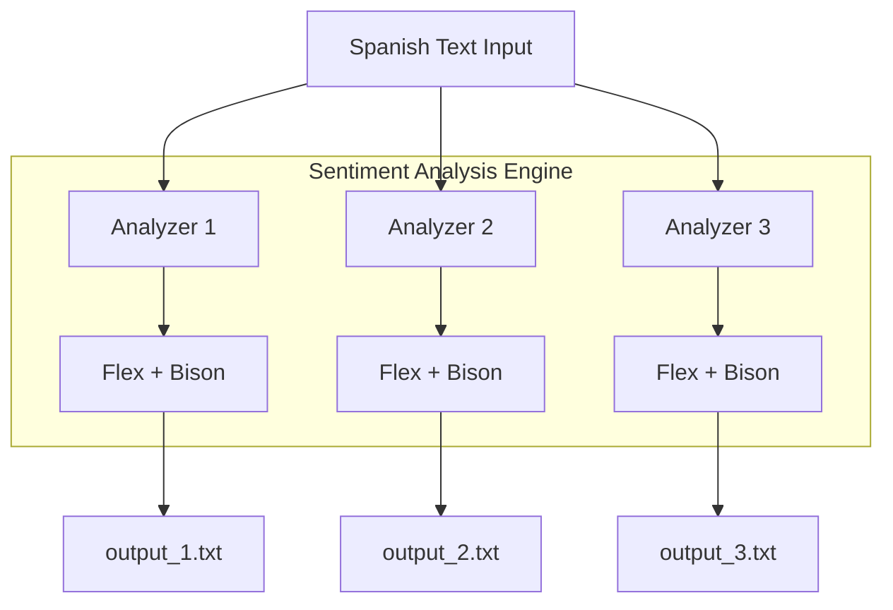
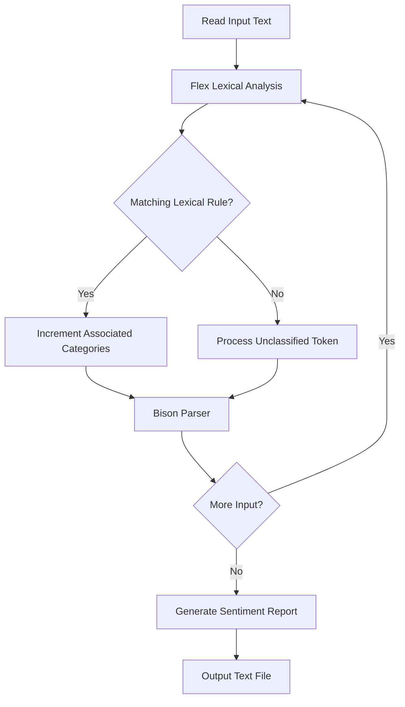

<div align="center">

# Sentiment Analyzer

**A rule-based sentiment and emotion analysis system built with C, Flex, and GNU Bison.**

Designed to identify emotional associations and sentiment polarity
in Spanish-language text through lexical analysis and deterministic rules.


</div>

---

## Overview

**Sentiment Analyzer** is an academic software project that implements a rule-based approach to sentiment and emotion analysis in Spanish-language text.

The system combines lexical analysis using Flex with syntactic analysis using GNU Bison to recognize words and expressions associated with predefined emotional categories.

Unlike machine learning-based sentiment analysis systems, this implementation relies on explicit lexical rules and deterministic processing, making its classification mechanism transparent and interpretable.

The project explores the application of compiler construction techniques to Natural Language Processing (NLP), demonstrating how lexical recognition and semantic associations can be used to extract emotional information from textual data.

## Project Highlights

<div align="center">

| Analyzers | Emotional Categories | Polarity Categories | Input Language |
|:---:|:---:|:---:|:---:|
| **3** | **8** | **2** | **Spanish** |

</div>

## Key Features

- Rule-based sentiment and emotion analysis.
- Spanish-language lexical recognition.
- Recognition of individual words and predefined multi-word expressions.
- Classification across eight emotional categories.
- Positive and negative sentiment polarity detection.
- Multiple emotional associations for a single lexical expression.
- Three analyzers containing different lexical rule sets.
- Text file and standard input processing.
- Independent sentiment reports for each analyzer.
- Deterministic and interpretable classification rules.
- Automated compilation scripts using Flex, Bison, and GCC.

---

## System Architecture

The system is organized into three lexical analyzers, each containing its own set of sentiment recognition rules and a Bison parser.

Each analyzer can process the same input independently and generate a report containing its corresponding emotional and sentiment counters.



The analyzers contain different portions of the lexical rule set. Their individual reports represent the associations recognized by each component.

The architecture does not require a trained machine learning model or an external inference service.

### Core Components

| Component | Responsibility |
|:---|:---|
| Flex Lexer | Recognizes words and expressions using predefined lexical rules. |
| Bison Parser | Processes tokens and coordinates the parsing workflow. |
| Sentiment Counters | Accumulates emotional and polarity associations. |
| Shared Header | Declares counters shared between the lexer and parser. |
| Input Handler | Reads text from a file or standard input. |
| Report Generator | Writes the resulting sentiment counters to a text file. |

---

## Sentiment and Emotion Categories

The system evaluates ten categories, consisting of eight emotions and two sentiment polarity indicators.

### Emotional Categories

| Emotion | Spanish Identifier | Description |
|:---|:---|:---|
| Joy | `alegria` | Happiness and pleasurable emotional associations. |
| Sadness | `tristeza` | Sorrow and unfavorable emotional associations. |
| Anger | `enfado` | Hostility, frustration, and irritation. |
| Fear | `miedo` | Threat-related and fearful associations. |
| Trust | `confianza` | Confidence and reliability. |
| Disgust | `asco` | Aversion and rejection. |
| Surprise | `sorpresa` | Unexpected events and reactions. |
| Anticipation | `anticipacion` | Expectations and future-oriented associations. |

### Sentiment Polarity

| Category | Spanish Identifier |
|:---|:---|
| Positive | `positivo` |
| Negative | `negativo` |

A single lexical expression may increment multiple categories simultaneously.

Consequently, emotional associations are not mutually exclusive, and the sum of all category counters may exceed the number of words in the input.

---

## Analysis Workflow

The sentiment analysis process consists of lexical recognition, category assignment, counter accumulation, and report generation.



### Lexical Recognition

Flex identifies predefined words and expressions and executes their corresponding semantic actions.

For example, a simplified lexical rule may associate a word with multiple emotional categories:

```lex
"abrazo" {
    sorpresa++;
    confianza++;
    alegria++;
    anticipacion++;
    positivo++;
    return SENTIMENT;
}
```

When the expression is recognized, the associated counters are incremented and a `SENTIMENT` token is returned to the parser.

### Syntactic Analysis

GNU Bison processes the tokens generated by the lexical analyzer.

The grammar accepts recognized sentiment tokens and ordinary word tokens:

```bison
%token SENTIMENT
%token WORD

%%

text:
    | text sentence
    ;

sentence:
    SENTIMENT
    | WORD
    ;

%%
```

The parser coordinates input processing, while the lexical rules perform the emotional category assignments.

### Report Generation

After processing the input, the application writes the accumulated counters to the corresponding output file.

Each analyzer produces an independent report:

- `output_1.txt`
- `output_2.txt`
- `output_3.txt`

---

## Technology Stack

<div align="center">


</div>

| Category | Technology |
|:---|:---|
| Programming Language | C |
| Lexical Analyzer Generator | Flex |
| Parser Generator | GNU Bison |
| Compiler | GCC |
| Build Automation | Shell Scripts |
| Text Processing | Rule-Based Natural Language Processing |
| Data Representation | Lexical Rules and Integer Counters |
| Input and Output | Standard C File I/O |
| Version Control | Git and GitHub |

---

## Getting Started

### Prerequisites

The following tools are required to regenerate and compile the analyzers:

- GCC
- Flex
- GNU Bison
- Git
- Bash-compatible terminal

### Install Dependencies

#### Ubuntu / Debian

```bash
sudo apt update
sudo apt install build-essential flex bison libfl-dev git
```

#### Windows

A compatible development environment such as Windows Subsystem for Linux (WSL) or MSYS2 can be used.

When using WSL, follow the Linux installation instructions.

### Clone the Repository

```bash
git clone https://github.com/JuanArchila13/Sentiments_Analyzer.git
cd Sentiments_Analyzer
```

### Build the Analyzers

Each analyzer contains an independent compilation script named `comandos.sh`.

Run the following commands from the repository root:

```bash
(cd Analizador1 && bash comandos.sh)
(cd Analizador2 && bash comandos.sh)
(cd Analizador3 && bash comandos.sh)
```

Alternatively, the analyzers can be compiled manually.

#### Analyzer 1

```bash
cd Analizador1

bison -d sentiments_lex.y
flex sentiments_lex1.l

gcc sentiments_lex.tab.c lex.yy.c \
    -lfl -o sentiments_lex_1.exe
```

#### Analyzer 2

```bash
cd Analizador2

bison -d sentiments_lex.y
flex sentiments_lex2.l

gcc sentiments_lex.tab.c lex.yy.c \
    -lfl -o sentiments_lex_2.exe
```

#### Analyzer 3

```bash
cd Analizador3

bison -d sentiments_lex.y
flex sentiments_lex3.l

gcc sentiments_lex.tab.c lex.yy.c \
    -lfl -o sentiments_lex_3.exe
```

Execute each compilation sequence from the repository root before entering the corresponding directory.

The `.exe` suffix is retained to match the original build scripts. The actual executable format depends on the compilation platform.

### Run the Analyzers

From the repository root, execute the newly compiled analyzers against the same input file:

```bash
./Analizador1/sentiments_lex_1.exe input.txt
./Analizador2/sentiments_lex_2.exe input.txt
./Analizador3/sentiments_lex_3.exe input.txt
```

The output reports are generated in the current working directory.

### Standard Input

The analyzers also support text supplied through standard input:

```bash
echo "abrazo" | ./Analizador1/sentiments_lex_1.exe
```

---

## Example Analysis

The repository includes the following sample input:

```text
me siento muy feliz hoy, todo esta saliendo bien.
```

One of the included reports, `output_2.txt`, contains the following results:

```text
Tristeza: 0
Sorpresa: 0
Anticipacion: 1
Miedo: 0
Enfado: 0
Positivo: 1
Confianza: 1
Asco: 0
Alegria: 1
Negativo: 0
Total de Palabras: 4
```

### Result Interpretation

| Category | Count |
|:---|:---:|
| Anticipation | 1 |
| Positive | 1 |
| Trust | 1 |
| Joy | 1 |
| Other categories | 0 |

The report contains four accumulated category associations.

> The field `Total de Palabras` represents the sum of the emotional and polarity counters, not the actual number of words in the input text.

This example is taken from the existing repository output. It is not a newly executed benchmark or an accuracy evaluation.

---

## Project Structure

```text
Sentiments_Analyzer/
│
├── Analizador1/
│   ├── sentiments_lex1.l
│   ├── sentiments_lex.y
│   ├── sentiments_lex.tab.c
│   ├── sentiments_lex.tab.h
│   ├── lex.yy.c
│   ├── common.h
│   ├── comandos.sh
│   ├── entrada.txt
│   └── salida.txt
│
├── Analizador2/
│   ├── sentiments_lex2.l
│   ├── sentiments_lex.y
│   ├── sentiments_lex.tab.c
│   ├── sentiments_lex.tab.h
│   ├── lex.yy.c
│   ├── common.h
│   └── comandos.sh
│
├── Analizador3/
│   ├── sentiments_lex3.l
│   ├── sentiments_lex.y
│   ├── sentiments_lex.tab.c
│   ├── sentiments_lex.tab.h
│   ├── lex.yy.c
│   ├── common.h
│   └── comandos.sh
│
├── Analizador-de-Sentimientos-APP
├── input.txt
├── output_1.txt
├── output_2.txt
├── output_3.txt
├── sentiments_lex_1.exe
├── sentiments_lex_2.exe
├── sentiments_lex_3.exe
└── README.md
```

### Main Source Files

| File | Description |
|:---|:---|
| `sentiments_lexN.l` | Flex lexical rules for analyzer N. |
| `sentiments_lex.y` | Bison grammar and report generation logic. |
| `common.h` | Shared declarations for sentiment counters. |
| `comandos.sh` | Compilation automation script. |
| `lex.yy.c` | C source generated by Flex. |
| `sentiments_lex.tab.c` | Parser source generated by Bison. |
| `sentiments_lex.tab.h` | Parser token definitions. |
| `input.txt` | Sample input text. |
| `output_N.txt` | Individual sentiment analysis report. |

---

## Engineering Concepts

The project demonstrates the integration of compiler construction and natural language processing techniques.

| Concept | Application |
|:---|:---|
| Lexical Analysis | Recognition of words and expressions using Flex. |
| Syntactic Analysis | Token processing through GNU Bison. |
| Formal Grammars | Definition of accepted token sequences. |
| Semantic Actions | Execution of category-specific counter operations. |
| Rule-Based NLP | Emotional associations based on predefined lexical rules. |
| Deterministic Processing | Explicit and reproducible classification logic. |
| Modular Design | Separation of lexical rules into three analyzers. |
| Build Automation | Automated source generation and compilation. |
| Explainability | Direct mapping between lexical rules and category assignments. |

---

## Advantages of the Rule-Based Approach

- Transparent and interpretable classification logic.
- No model training or GPU infrastructure required.
- Explicit control over emotional associations.
- Reproducible results for identical inputs and configurations.
- Straightforward extension through additional lexical rules.
- Educational integration of compiler design and NLP concepts.

---

## Current Limitations

The project is an educational implementation of lexical sentiment analysis rather than a production-ready contextual NLP system.

- Classification depends on predefined lexical rules.
- Unknown expressions may not contribute to sentiment counters.
- Case differences, accents, and spelling variations may affect recognition.
- Sarcasm, irony, and contextual ambiguity are not reliably resolved.
- Negation is limited to explicitly defined lexical patterns.
- Individual analyzers generate separate reports.
- Category totals do not represent unique word counts.
- No validated accuracy, precision, recall, or F1-score is currently documented.
- The system does not produce calibrated sentiment probabilities.

---

## Future Improvements

- [ ] Consolidate lexical rules into a unified analysis engine.
- [ ] Implement centralized aggregation of analyzer reports.
- [ ] Add Unicode and Spanish accent normalization.
- [ ] Implement case-insensitive lexical recognition.
- [ ] Improve contextual negation handling.
- [ ] Introduce normalized sentiment scores.
- [ ] Export structured results in JSON or CSV format.
- [ ] Add automated unit and integration tests.
- [ ] Evaluate performance using labeled Spanish-language datasets.
- [ ] Compare rule-based results against machine learning approaches.
- [ ] Introduce a REST API for external application integration.
- [ ] Implement a unified cross-platform build system.
- [ ] Automate compilation and testing with GitHub Actions.

---

## License

No explicit open-source license is currently included in this repository.

---

## Author

**Juan Pablo Archila Amaya**  
Software Engineer

[](https://github.com/JuanArchila13)
[](https://www.linkedin.com/in/juan-pablo-archila-amaya)
[](https://juanarchila13.github.io/portfolio)

---

<div align="center">

Developed as an academic exploration of compiler construction,
lexical analysis, and Natural Language Processing.

**C · Flex · GNU Bison · NLP**

</div>
